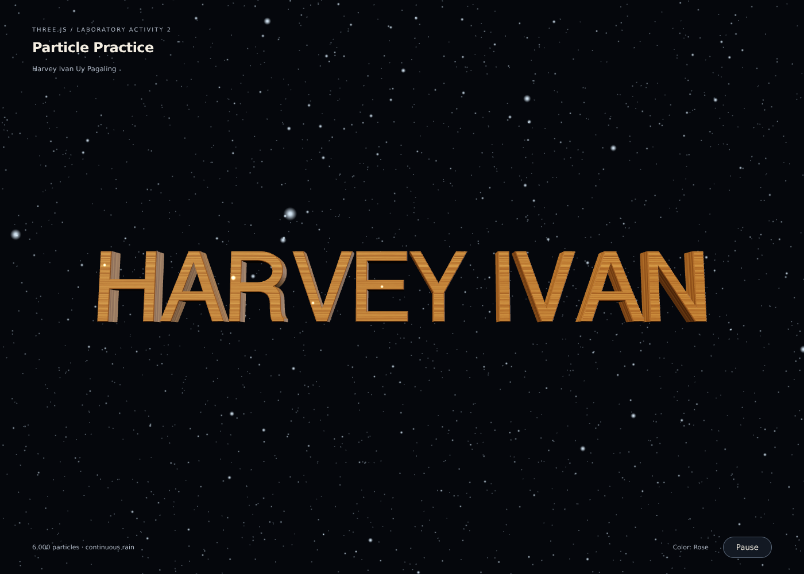

# M2 LA2 - PAGALING

Laboratory Activity 2: Particle Practice (Three.js)
Harvey Ivan Uy Pagaling

## Requirements implemented

- 6,000 rain particles keep falling using a fixed pool of positions.
- Particles wrap from the bottom to the top with overshoot preserved. The entire cloud no longer drifts out of view.
- Real `TextGeometry` spells **HARVEY IVAN**, replacing the wooden box.
- The text has a locally generated wooden grain texture.
- Particle colors change every **3 seconds of running animation**: ice blue, rose, mint, gold, then repeat.
- The website title is **M2 LA2 - PAGALING**.
- External JavaScript and CSS use organized folders and descriptive names.
- No blocking infinite loop. Each animation frame performs one finite pass over the particle pool. Pause stops animation time and rain; Resume continues.
- Full-screen rendering adapts to desktop and mobile.

## Run

Open the folder with VS Code Live Server, or run `python -m http.server 8000` here and visit http://localhost:8000. On Windows, `py -m http.server 8000` also works. Use HTTP because the code uses ES modules and loads a local font. Requires WebGL 2. Three.js and the font are included locally; no CDN or package installation is needed.

## Why the starter stopped raining

The lesson code moved `stars.position.y` downward. Once the whole cloud left the camera view, no particles came back. This version updates each particle's Y value in a `BufferGeometry` attribute and wraps it back inside the vertical range. The X and Z values remain stable, so motion is vertical. `attribute.needsUpdate = true` uploads the updated positions to the GPU.

## Files

- `index.html`: page title, canvas, controls
- `assets/css/style.css`: full-screen responsive styling
- `assets/js/main.js`: scene, wooden text, lighting, timing
- `assets/js/particles.js`: fixed particle pool, recycling, three-second palette
- `assets/fonts/`: Helvetiker font and its license
- `vendor/three/`: Three.js 0.186.1, TextGeometry, FontLoader, MIT license
- `preview.png`: actual browser-rendered screenshot

## Validation

Browser tests passed for 600 seconds of simulated rain: all 6,000 particles remained in bounds and moving, with unchanged X/Z values. A bottom-boundary example wrapped from -34.5 to 34.5 after falling one unit. Colors were checked before three seconds, at 3/6/9 seconds, and at the 12-second repeat. TextGeometry, wood mapping, pause/resume, and full-screen sizes 1400×1000 and 390×844 passed. No JavaScript errors or failed resource requests occurred.

## References and attribution

Assignment starter: [JoshelCabig/threejs-particle-practice](https://github.com/JoshelCabig/threejs-particle-practice), inspected at commit `fda0e550d68dc2814ecf695c8649b48f6cdf8cd4`. This submission reimplements the lesson with modern Three.js modules and particle recycling.

Three.js: [mrdoob/three.js](https://github.com/mrdoob/three.js). MIT license included in `vendor/three/LICENSE`. Helvetiker font supplied by the Three.js examples; MAGENTA font license included in `assets/fonts/LICENSE.txt` and its original metadata. Wood and particle sprite textures are generated locally.
